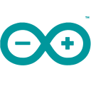
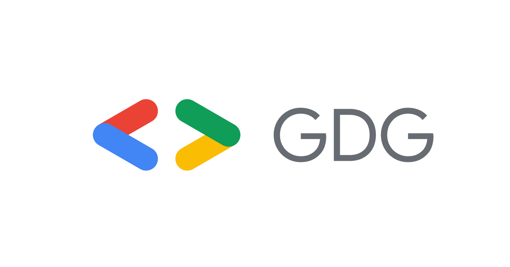

<!--
  ============================================================
  ANISH SINHA — GITHUB PROFILE README
  ------------------------------------------------------------
  version.json drives the auto-updating "PROFILE" badge below.
  Edit version.json (not this file) when you bump the version.
  ============================================================
-->

<div align="center">


<br>

<!-- 🔁 AUTO-UPDATING VERSION BADGE — pulls live from version.json. Edit version.json to bump this. -->


</div>

<br>


<br>

## 01 — ABOUT

<table>
<tr>
<td width="55%" valign="top">

```
┌──────────────────────────────────────────┐
│  ●  ●  ●                     anish.sh     │
├──────────────────────────────────────────┤
class AnishSinha:
    education = "B.Tech-MBA | CSBS"
    university = "Pondicherry University"

    interests = [
        "AI / ML",
        "IoT",
        "Software",
        "FinTech"
    ]

    mindset = [
        "build",
        "experiment",
        "iterate"
    ]
└──────────────────────────────────────────┘
```

</td>
<td width="45%" valign="top">

I'm a **Computer Science & Business Systems** student at Pondicherry University. I like understanding systems from the inside, turning rough ideas into working prototypes, and learning by building.

**Focus**
🧠 Artificial Intelligence
⚙️ Software Engineering & Web Development
📡 IoT & Connected Systems
💳 FinTech
🛰️ Defence & Emerging Technology

</td>
</tr>
</table>

<br>

## 02 — STACK / SYSTEMS

<div align="center">

<a href="https://www.python.org/"></a>
<a href="https://www.java.com/"></a>
<a href="https://en.wikipedia.org/wiki/C_(programming_language)"></a>
<a href="https://isocpp.org/"></a>
<a href="https://developer.mozilla.org/en-US/docs/Web/HTML"></a>
<a href="https://developer.mozilla.org/en-US/docs/Web/CSS"></a>
<a href="https://react.dev/"></a>
<a href="https://www.mysql.com/"></a>
<a href="https://git-scm.com/"></a>
<a href="https://github.com/"></a>
<a href="https://www.arduino.cc/"></a>
<a href="https://www.raspberrypi.com/"></a>
<a href="https://www.blender.org/"></a>
<a href="https://www.tinkercad.com/"></a>

</div>

<br>

## 03 — COMMUNITIES

<div align="center">
<table>
<tr>
<td align="center" width="33%">
<a href="https://developers.google.com/community/gdg">

</a>
<br><br>
<b>Google Developer Group</b>
<br>
<sub>Developer Community</sub>
</td>
<td align="center" width="33%">
<a href="https://fossunited.org/">

</a>
<br><br>
<b>FOSS United</b>
<br>
<sub>Open Source Community</sub>
</td>
<td align="center" width="33%">
<a href="https://ecell.iitb.ac.in/">

</a>
<br><br>
<b>E-Cell, IIT Bombay</b>
<br>
<sub>Entrepreneurship Community</sub>
</td>
</tr>
</table>
</div>

<br>

## 04 — GITHUB STATS

<!--
  ⚠️ IMPORTANT: These three cards currently point to the public shared
  github-readme-stats / streak-stats instances. Those public instances
  are frequently rate-limited by GitHub's API and WILL intermittently
  fail (the "sad face" error). For a permanently reliable version:
    1. Fork https://github.com/anuraghazra/github-readme-stats
    2. Deploy your fork to your own free Vercel account
    3. Add your own GitHub Personal Access Token as an env variable there
    4. Replace the two domains below with your own Vercel deployment URL
  Same process for streak stats: https://github.com/DenverCoder1/github-readme-streak-stats
  Until you self-host, this section may occasionally fail to load — that
  is a limitation of the free public API, not of this README's code.
-->

<div align="center">
<table>
<tr>
<td valign="top" width="50%">

</td>
<td valign="top" width="50%">

<br>

</td>
</tr>
</table>
</div>

<br>

## 05 — ACTIVITY

<div align="center">

</div>

<br>


<br>

## 06 — NOTE

<!--
  🔁 This line cycles through 8 tech/programming quotes, one at a time, on loop.
  Edit the "lines=" text below to change a quote — keep each short and
  end it with "- Author Name".
-->
<div align="center">


</div>

<br>

## 07 — NETWORK

<!-- 🔗 EDIT HERE: replace each href="..." below with YOUR actual profile link -->
<div align="center">

<a href="https://github.com/iamanishsinha">

</a>

<br><br>

<a href="https://www.linkedin.com/in/iamanishsinha/">

</a>

<br><br>

<a href="https://https://x.com/iamanishsinha_">

</a>

<br><br>

<a href="https://your-portfolio-link.com">

</a>

<br><br>

<a href="mailto:anishsinha.edu@gmail.com">

</a>

</div>


<br>

<div align="center">
<sub>README auto-versioned via <code>version.json</code> · Last redesigned August 2026</sub>
</div>
